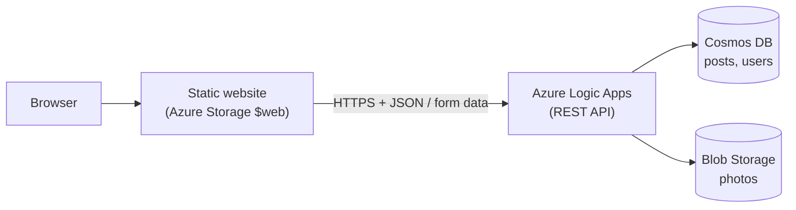
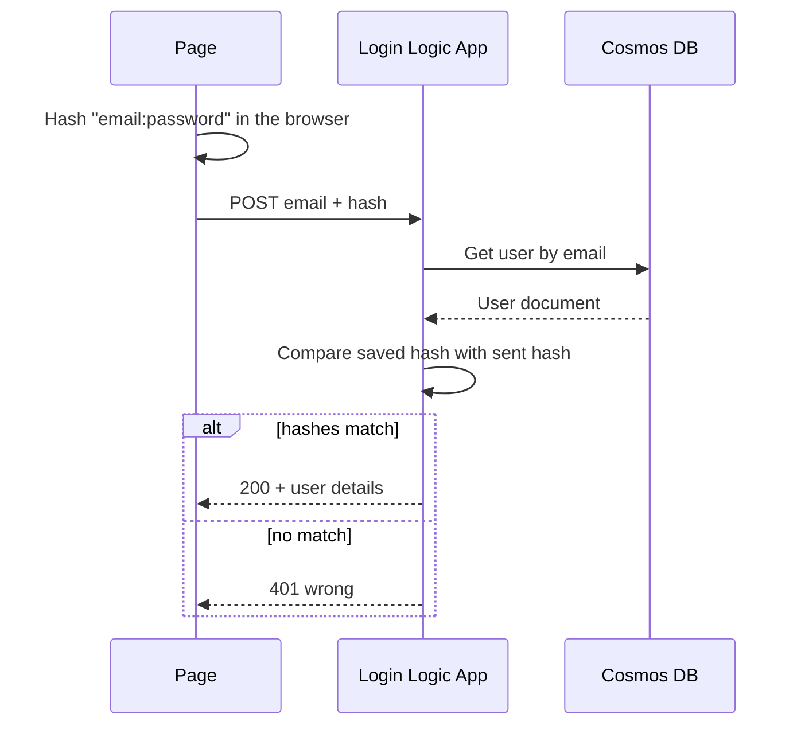

# UniPulse

**A small social network for university students, built entirely on Azure.**

Students create an account, share what is on their mind with an optional photo, and see what their course mates are posting. There is no server to manage: the website is static and every action goes through a serverless REST API.


Built for **COM682 Cloud Native Development**, Ulster University.

<!-- Add screenshots to docs/screenshots/ and uncomment:
| Home | Create post | Profile |
|------|-------------|---------|
|  |  |  |
-->

---

## Contents
- [Features](#features)
- [How it works](#how-it-works)
- [Tech stack](#tech-stack)
- [REST API](#rest-api)
- [Data model](#data-model)
- [Getting started](#getting-started)
- [Deployment](#deployment)
- [Security](#security)
- [Project status](#project-status)
- [Project structure](#project-structure)
- [What I learned](#what-i-learned)
- [Author](#author)

---

## Features
- **Accounts.** Register and log in with your university email. A session is kept in the browser until you log out.
- **Posts.** Write a message, optionally add a photo, and see it on the shared feed.
- **Your profile.** See your details and your own posts, and edit or delete them.
- **Mobile-first.** A simple layout with a bottom navigation bar, designed for a phone screen.
- **Full CRUD.** Create, read, update and delete are all handled through the REST API.

## How it works
The browser only talks to the Logic Apps. The Logic Apps talk to the database and the storage. Nothing else is exposed.



**What happens when you log in**



## Tech stack
| Layer | Technology |
|-------|------------|
| Front end | HTML, CSS and vanilla JavaScript (single page, hash router) |
| API | Azure Logic Apps (Consumption) |
| Database | Azure Cosmos DB for NoSQL (serverless) |
| Media | Azure Blob Storage |
| Hosting | Azure Storage static website |
| Source control | Git and GitHub |

## REST API
Every endpoint is a Logic App with an HTTP trigger and allows cross-origin calls.

| Name | Method | Path | What it does |
|------|--------|------|--------------|
| Register | POST | `/` | Create an account. Form field `doc` holds the user JSON |
| Login | POST | `/` | Log in. Form fields `email` and `hash`. Returns `200` with the user, or `401` |
| IUPS | POST | `/` | Upload a post. Form fields `FileName`, `caption`, `userID`, `userName`, `File` |
| RAI | GET | `/` | Get all posts |
| RIPS | GET | `/{id}` | Get one post |
| UIPS | PUT | `/{id}` | Update a post (JSON body) |
| DIPS | DELETE | `/{id}` | Delete a post |

## Data model
**`posts` container**
```json
{
  "id": "JTJmcGhvdG9z...",
  "fileName": "Hello UniPulse",
  "caption": "Hello UniPulse",
  "filePath": "/photos/639301076410218802",
  "userID": "student@ulster.ac.uk",
  "userName": "Parwat|Computing"
}
```

**`users` container**
```json
{
  "id": "student@ulster.ac.uk",
  "userID": "student@ulster.ac.uk",
  "name": "Parwat",
  "mail": "student@ulster.ac.uk",
  "sex": "Male",
  "subject": "Computing Systems",
  "year": "Sep 2024",
  "passwordHash": "sha-256 hex string"
}
```
`userName` stores the name and the course together as `Name|Course`, so every post can show the author's course without an extra lookup.

## Getting started

### What you need
- An Azure subscription with the resources above already created
- The seven Logic App links (one per endpoint)
- Any static file server, such as the VS Code Live Server extension or Python

### Run it locally
1. Clone the repo:
   ```bash
   git clone https://github.com/YOUR-USERNAME/unipulse-web.git
   cd unipulse-web/src
   ```
2. Copy the sample config and fill in your own links:
   ```bash
   cp config.sample.js config.js
   ```
3. Start a local server and open the address it prints:
   ```bash
   python3 -m http.server 8000
   ```
   Then go to http://localhost:8000.

`config.js` holds secret keys, so it is listed in `.gitignore` and never committed.

## Deployment
**Manual (works today)**
1. In the storage account, turn on **Static website** with `index.html` as the index document.
2. Upload `index.html` and `config.js` to the `$web` container.

**Automated (planned)**
A pipeline will build `config.js` from secret variables and copy `src/` to `$web` on every push to `main`. No secrets will be stored in the repository.

## Security
- Real Logic App links live only in `config.js`, which is ignored by git.
- Passwords are never stored in plain text. The browser makes a SHA-256 hash of `email:password`, and only the hash is saved and compared.
- All text from users is shown with `textContent`, never as raw HTML.

**Honest limits.** This is a coursework project. A production app should use a slow, salted password hash such as Argon2 or bcrypt on the server, or better, a managed identity service like Microsoft Entra External ID. The API links also act as shared secrets, so a real product would add proper authentication on every endpoint.

## Project status
- [x] Blob storage for photos
- [x] Cosmos DB for posts and users
- [x] Logic Apps REST API with full CRUD
- [x] Register and login
- [x] Static website hosting
- [ ] CI/CD pipeline
- [x] Azure Function (advanced feature)
- [ ] Translator or Q&A (advanced feature)

## Project structure
```
unipulse-web/
├── src/
│   ├── index.html          the whole app (HTML, CSS and JavaScript)
│   └── config.sample.js    template for your own links
├── .github/
│   └── pull_request_template.md
├── .gitignore
└── README.md
```

## What I learned
- Logic Apps can be a real REST API, but the order of actions matters. A Response placed before the data step returns empty data.
- A Cosmos DB container needs the right partition key, and every Get, Update and Delete must match it.
- Browsers send a preflight check for PUT and DELETE, so the API must allow cross-origin calls.
- Keeping secrets out of git from the first commit is much easier than cleaning them out later.

## Author
**Parwat**, BSc Computing, Ulster University